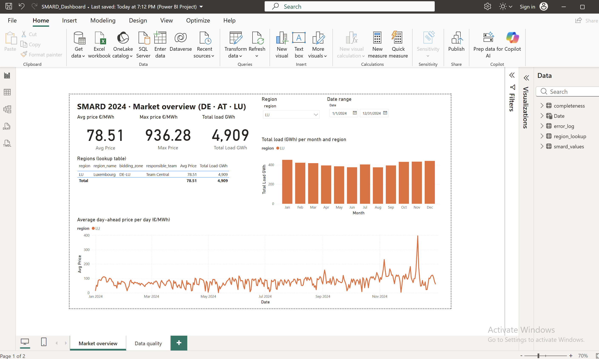
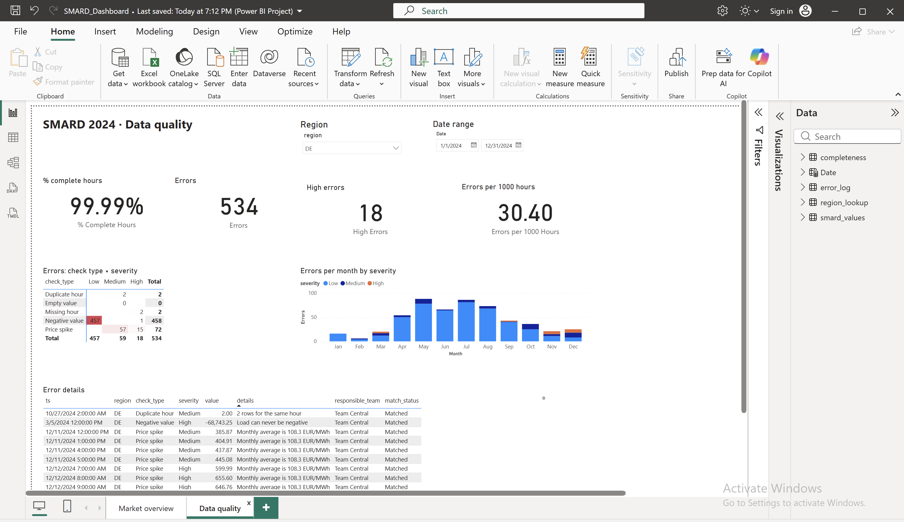

# SMARD Energy Data Quality Dashboard – Power BI Project

## Project Overview
This project loads hourly electricity market data for 2024 from SMARD (the market data platform of the German Federal Network Agency), checks it for data quality problems, and shows the results in a Power BI dashboard.

It covers three regions: Germany (DE), Austria (AT) and Luxembourg (LU), with hourly grid load and day-ahead prices.

## Business Objective
Give a clear view of both the market and the quality of the data behind it:
- How much electricity was used and what it cost, per region and over time
- Which data problems exist (missing hours, duplicates, empty values, negative values, price spikes)
- How serious each problem is and which team is responsible for the region
- How complete the data is overall

## Tools Used
- PostgreSQL (tables, views, data quality checks in SQL)
- Python – pandas, SQLAlchemy, openpyxl (loading, export, alternative checks)
- Power BI (Power Query, data modeling, DAX, dashboard)
- Excel (region lookup table, clean exports per region)

## Data Source
[SMARD Strommarktdaten](https://www.smard.de) – Bundesnetzagentur, licensed under CC BY 4.0.

| File | Content |
|---|---|
| `load_DE.csv`, `load_AT.csv`, `load_LU.csv` | Hourly grid load (Netzlast) in MWh |
| `prices.csv` | Hourly day-ahead price in €/MWh for the DE-LU and AT bidding zones |

8,784 hours per region (2024 is a leap year). Germany and Luxembourg share one bidding zone, so they have the same price.

## Workflow
1. **Extract** – download the 2024 series from SMARD (`get_smard_2024.py`)
2. **Load** – read the German-formatted CSVs, reshape from wide to long and load into PostgreSQL (`load_smard.py`)
3. **Check** – run 5 data quality checks and write every finding into an `error_log` table (`03_run_checks.sql`)
4. **Clean & export** – clean view without duplicates, empty or negative values, exported as one Excel file per region (`export_by_region.py`)
5. **Report** – Power BI dashboard with a market page and a data quality page

## Data Quality Checks

| Check | Method | Severity |
|---|---|---|
| Missing hour | Generate every expected hour (`generate_series`) and left join to the real data | High |
| Duplicate hour | More than one row for the same dataset, region and hour (`GROUP BY … HAVING`) | Medium |
| Empty value | Row exists but the value is NULL | Medium |
| Negative value | Value below zero – High for load (impossible), Low for price (real market event) | High / Low |
| Price spike | More than 3 standard deviations from the monthly average per region (more than 5 = High) | Medium / High |

All findings are stored in one table, `error_log` (dataset, timestamp, region, check type, severity, value, details).

To prove the checks work, `inject_test_errors.sql` adds known problems (deleted hours, duplicated day, empty prices, a negative load and a 2,500 €/MWh price). All of them are detected.

## Results

| Metric | Real data | With test errors |
|---|---|---|
| Rows checked | 52,704 | 52,723 |
| Errors found | 1,490 | 1,539 |
| High severity | 50 | 56 |
| % complete hours | 99.99 % | 99.93 % |

- The only missing and duplicate hours are the daylight saving time changes (31 March and 27 October). Storing timestamps in UTC would remove them.
- 1,210 negative prices, mostly on sunny spring and summer days – a real market effect, not bad data.
- The highest price spikes were on 12 December 2024 (up to 936 €/MWh in DE-LU) during a period with little wind and sun.

## Data Model
Star schema with two dimension tables:
- `Date` (DAX `CALENDAR`) linked by `day`
- `region_lookup` (Excel) linked by `region`

Fact tables: `smard_values`, `error_log`, `completeness`. In Power Query, `error_log` is merged with `region_lookup` (left outer join) to add the responsible team and a Matched / Unmatched status.

## DAX Measures
- Avg Price, Max Price, Total Load GWh
- Errors, High Errors
- % Complete Hours
- Errors per 1000 Hours

## Dashboard

### Market overview
KPI cards, regions table from the lookup, load per month and region, and average day-ahead price per day.



### Data quality
Completeness and error KPIs, a heatmap of check type × severity, errors per month by severity, and an error detail table with the responsible team.



## Project Structure
```
SMARD-Energy-Data-Quality/
├── sql/
│   ├── 01_create_tables.sql
│   ├── 02_error_log.sql
│   ├── 03_run_checks.sql
│   ├── 04_completeness.sql
│   ├── 05_clean_export_view.sql
│   └── inject_test_errors.sql
├── python/
│   ├── get_smard_2024.py
│   ├── load_smard.py
│   ├── export_by_region.py
│   ├── fallback_no_postgres.py
│   ├── data/               raw SMARD CSV files
│   ├── export/             clean Excel file per region
│   └── csv_for_powerbi/    data used by the dashboard
├── powerbi/                Power BI project (SMARD_Dashboard.pbip)
├── region_lookup.xlsx
├── screenshot/
└── requirements.txt
```

## How to Run
```bash
pip install -r requirements.txt
cd python
export SMARD_DB_URL="postgresql+psycopg2://postgres:<password>@localhost:5432/smard"
```
1. Run `sql/01_create_tables.sql` in the `smard` database
2. `python load_smard.py`
3. Run `sql/02_error_log.sql`, `sql/03_run_checks.sql`, `sql/05_clean_export_view.sql`, `sql/04_completeness.sql`
4. `python export_by_region.py`

Without PostgreSQL, `python fallback_no_postgres.py` runs the same checks in pandas and writes the CSV files for Power BI (`--inject` adds the test errors).

To open the dashboard, open `powerbi/SMARD_Dashboard.pbip` in Power BI Desktop, set the `DataFolder` parameter to the project folder and refresh.
